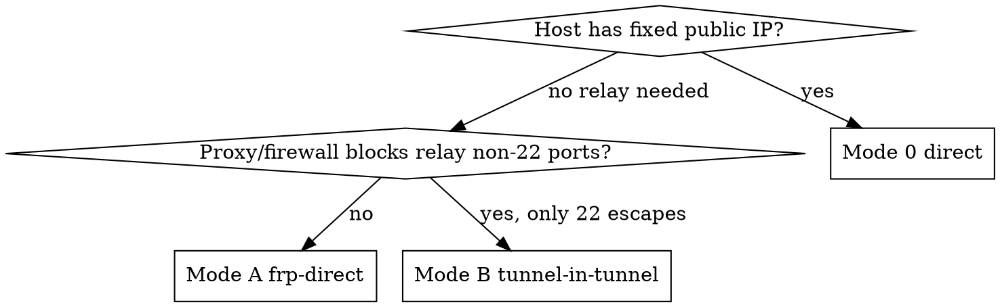

# Skill: mosh-tmux-remote

## Overview

Phone Termux reaches a work host via mosh (SSH bootstrap over TCP + roaming session over UDP) and always lands in a tmux session named `mosh`. Core principle: **mosh = TCP + UDP, both must be open; bare `mosh` picks a random UDP port and will fail — always pin with `-p`.**

## When to Use

- Phone Termux needs mosh access to a work host (new Linux machine or existing host)
- Choosing between direct public IP, frp-direct relay, or tunnel-in-tunnel relay
- Setting up tmux auto-attach that only triggers for mosh (never hijacks plain ssh/scp)
- Symptoms: mosh reports UDP unreachable while ssh works, `bind: Address already in use`, `Did not find remote IP address`, `Too many authentication failures`, lands on relay instead of host

When NOT to use: plain ssh without mosh, local-only tmux usage, VNC/desktop forwarding.

## Decision Flow



→ DECISION POINT 1 (mode): present Mode 0 / A / B with trade-offs, wait for the user's pick. Never silently default. Discriminator test: from the host, probe relay non-22 ports — if all blocked but 22 works, it is Mode B.

→ DECISION POINT 2 (which relay): if Mode A/B, ask which public relay machine to use. One relay per Host alias; multiple relays coexist as separate aliases.

→ DECISION POINT 3 (UDP range): default is the full range 60001–60005 (host, relay firewall, and frp proxies all aligned). Single-port 60001 only if the user explicitly accepts that a second concurrent mosh session will be unreachable.

Placeholders everywhere below: `HOST_USER`, `HOST_IP` (direct), `RELAY_IP`, `RELAY_USER`, `FRP_TOKEN`. Never write real IPs, tokens, or passwords into docs or repos.

## Port Conventions (locked)

| Path | SSH leg (TCP) | Mosh leg (UDP) |
|---|---|---|
| Mode 0 direct | `HOST_IP:22` | `HOST_IP:60001-60005` |
| Mode A/B via relay | `RELAY_IP:60022` → host `:22` | `RELAY_IP:60001-60005` → host `60001-60005` |

Firewall must open TCP 22 (direct) or TCP 60022 (relay) **plus** UDP 60001–60005. TCP-only success proves nothing about mosh.

## Host Setup (any OS, same principle)

1. Install: `sshd`, `mosh-server`, `tmux`, `frpc` (Modes A/B only). Record the server path: `command -v mosh-server`.
2. Keep the remote login shell clean: no bare `source` of possibly-missing files, no unconditional `echo` in `~/.bashrc`/`~/.zshrc` — any extra output breaks mosh handshake parsing (`Did not find remote IP address`).
3. tmux auto-attach, mosh-only (append to `~/.bashrc` or `~/.zshrc`, same snippet for both):

```bash
# mosh-only auto-attach, session name locked to "mosh"
if [ -z "$TMUX" ] && command -v tmux >/dev/null 2>&1; then
  case "$-" in *i*)
    if [ -n "$MOSH_CONNECTION" ]; then
      tmux attach-session -t mosh 2>/dev/null || tmux new-session -s mosh
      [ $? -eq 0 ] && exit
    fi
    ;;
  esac
fi
```

Fallback for exotic shells where `$MOSH_CONNECTION` is unset: walk up `$PPID` looking for a `mosh-server` ancestor with `ps`. Verify with `tmux display-message -p '#S'` showing `mosh` after a mosh login, and plain `ssh` staying untouched.

4. Modes A/B: write `frpc.toml` (Mode A points at relay frps port; Mode B points at `127.0.0.1:1443` inside the persistent `ssh -N -R 127.0.0.1:60022:127.0.0.1:22 -L 127.0.0.1:1443:127.0.0.1:443` tunnel, UDP proxies only — TCP rides the `-R`). Keep it alive with the OS resident mechanism (systemd user unit on Linux). Config files are `chmod 600`.

## Relay Setup (Modes A/B)

Minimal `frps.toml` (`bindPort` + token auth), run under systemd, open cloud firewall: TCP 22, TCP 60022, UDP 60001–60005 (Mode B may open 22 only plus UDP as needed).

## Phone Termux (copy-paste)

Run each block as-is after replacing the `RELAY_IP`/`HOST_IP` placeholders once.

```bash
# 0. one-time install
pkg update && pkg install -y openssh mosh
mkdir -p ~/.ssh && chmod 700 ~/.ssh && touch ~/.ssh/config && chmod 600 ~/.ssh/config
```

```bash
# 1. one-time Host entries (keep all three, use whichever applies)
cat >> ~/.ssh/config <<'EOF'
Host direct
  HostName HOST_IP
  Port 22
  User HOST_USER
  IdentityFile ~/.ssh/id_ed25519
  ServerAliveInterval 30
  ServerAliveCountMax 3
Host relay-a
  HostName RELAY_IP
  Port 60022
  User HOST_USER
  IdentityFile ~/.ssh/id_ed25519
  ServerAliveInterval 30
  ServerAliveCountMax 3
EOF
ssh-copy-id -p 22 HOST_USER@HOST_IP
# relay key: ssh-copy-id -p 60022 HOST_USER@RELAY_IP
```

```bash
# 2. one-time aliases (append to ~/.bashrc or ~/.zshrc, then source it)
cat >> ~/.bashrc <<'EOF'
alias d-mosh='pkill -f mosh 2>/dev/null; mosh -p 60001 direct'
alias d-mosh2='pkill -f mosh 2>/dev/null; mosh -p 60002 direct'
alias d-kill-mosh='ssh direct pkill mosh-server'
alias a-mosh='pkill -f mosh 2>/dev/null; mosh -p 60001 relay-a'
alias a-mosh2='pkill -f mosh 2>/dev/null; mosh -p 60002 relay-a'
alias a-kill-mosh='ssh relay-a pkill mosh-server'
EOF
source ~/.bashrc
```

```bash
# 3. daily use: clean stale local clients first, then connect with pinned port
pkill -f mosh 2>/dev/null; sleep 1
d-mosh
# if "bind: Address already in use", step to the next port:
d-mosh2
# most explicit form (custom server path, explicit ssh port):
mosh --ssh="ssh -p 22" --server="$(ssh direct command -v mosh-server)" -p 60001 HOST_USER@HOST_IP
```

```bash
# 4. verify you are on the host inside tmux
hostname; tmux display-message -p '#S'
# expect: your host name, and "mosh"
```

## Verification

1. `ssh <alias>` reaches the host (`hostname` matches, not the relay).
2. `mosh -p 60001 <alias>` lands in tmux session `mosh`.
3. Airplane-mode 10s → reconnect resumes the same session.
4. `ssh <alias> pkill mosh-server` then reconnect still works.

## Common Mistakes

| Symptom | Cause | Fix |
|---|---|---|
| UDP unreachable, ssh fine | Bare `mosh` picked an unmapped random UDP port | Always `-p 60001` (occupied → 60002–60005) |
| `bind: Address already in use` | Stale Termux mosh-client holds the local port | `pkill -f mosh`, then next port |
| `Did not find remote IP address` | Login-shell noise pollutes handshake | Guard `source` with existence checks, no unconditional output |
| `Too many authentication failures` | Wrong keys tried first | Align `IdentityFile`, or isolate with `-o PubkeyAuthentication=no` |
| Lands on relay shell | SSH leg hit relay `:22` instead of `:60022` | Alias `Port` must be 60022 for relay paths |
| TCP ok, UDP never ok | Firewall/security group lacks UDP or frp lacks UDP proxy | Open UDP 60001–60005 on both |
| Plain ssh drops into tmux | Unconditional `exec tmux` in rc file | Only auto-attach when `$MOSH_CONNECTION` is set |

## Real-World Impact

Distilled from huoshan frp-direct and txy tunnel-in-tunnel links: the random-port and local-bind failures each cost a full debug round before pinning + range + `pkill` discipline; the shell-noise failure masqueraded as a UDP firewall issue until rc files were guarded.
